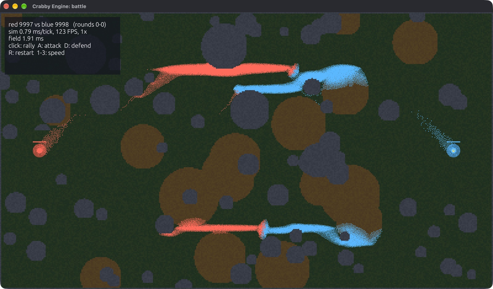
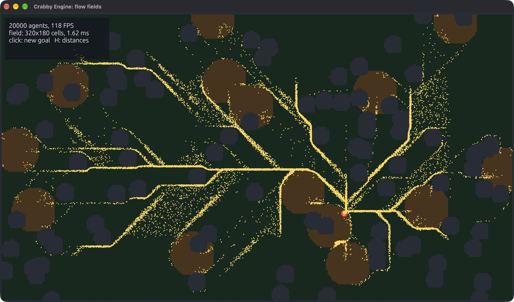
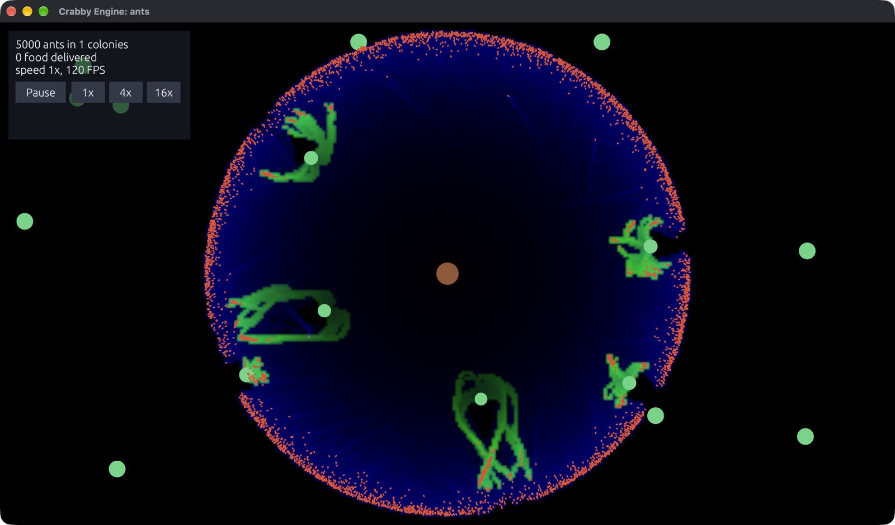
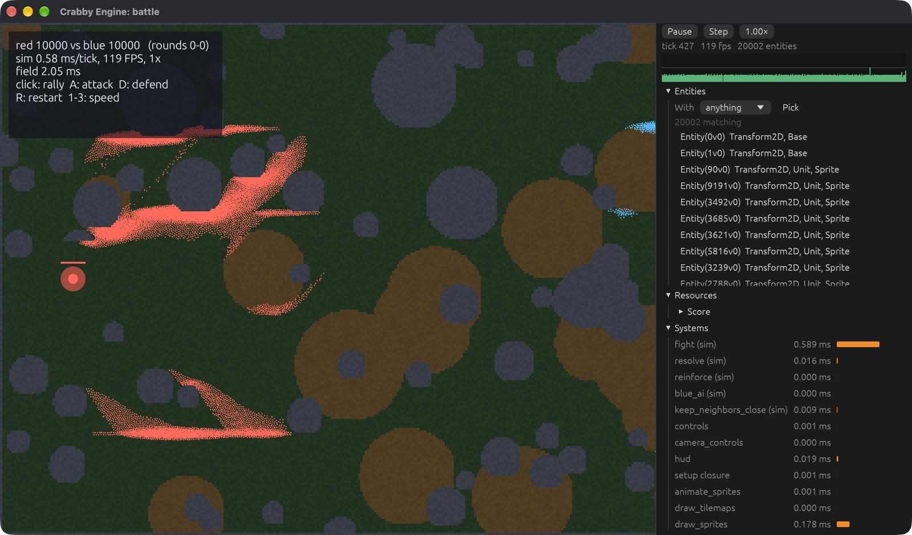

<div align="center">

# 🦀 Crabby Engine

**A fast 2D game engine for simulating millions of things.**

Colonies, crowds, armies, ecosystems, factories: games where the number of
simulated things is the point. Written in Rust, with a C++ API at close to
the same speed.

[](https://github.com/bozoslav/crabbyengine/actions/workflows/ci.yml)
[](https://bozoslav.github.io/crabbyengine/)
[](https://bozoslav.github.io/crabbyengine/api/crabbyengine/)
[](#license)


[**▶ Play in your browser**](https://bozoslav.github.io/crabbyengine/play/battle/) ·
[**Guide**](https://bozoslav.github.io/crabbyengine/) ·
[**Examples**](#examples) ·
[**Benchmarks**](https://bozoslav.github.io/crabbyengine/performance.html) ·
[**C and C++**](https://bozoslav.github.io/crabbyengine/c-cpp.html) ·
[**AI agents**](https://bozoslav.github.io/crabbyengine/agents.html)



<sub>The battle demo: 20,000 units on flow fields, 0.8 ms of simulation per frame.
It runs a million units headless at 19 ms per tick.</sub>

</div>

## Why Crabby Engine

- **Built for scale.** Its own archetype ECS runs queries on every CPU
  core: 10 million agents tick in 8.7 ms headless, and a million small
  sprites render at 120 FPS. A fixed-rate simulation clock runs separately from
  drawing, so the simulation can pause, step one tick, run at up to 64×, or
  run with no window at all.
- **Fast iteration.** Images, sounds, fonts and JSON data files reload while
  the game runs, and so does game code (`dx serve --hot-patch`), with all
  game state kept. Press `` ` `` for an in-game inspector that lists every
  entity and edits components live.
- **Agents can play it.** An [MCP](https://modelcontextprotocol.io) server
  lets AI coding agents launch your game, inspect and edit entities, step
  the simulation, watch events, read logs, and take screenshots.
- **Runs in the browser.** The same game builds for the web (WebGPU, with
  WebGL2 as a fallback): [play the battle demo](https://bozoslav.github.io/crabbyengine/play/battle/).
- **Rust or C++.** A header-only C++17 wrapper over a C API covers nearly the
  whole engine. The C++ version of the battle demo is within 6% of the Rust
  speed.
- **Simple, replaceable parts.** One obvious way to do each thing. Everything
  the engine does on its own (drawing sprites, camera controls, attachments)
  is a plain system you can remove or replace.

## A first look

<table>
<tr><th>Rust</th><th>C++</th></tr>
<tr>
<td>

```rust
use crabbyengine::*;

struct Vel(Vec2);

fn movement(ctx: &mut Ctx) {
    let dt = ctx.dt();
    ctx.world
        .query::<(&mut Transform2D, &Vel)>()
        .par_for_each(|(t, v)| t.position += v.0 * dt);
}

fn main() {
    Game::new("Crabs", 1280, 720)
        .sim_system(movement)
        .run(|ctx| {
            let crab = ctx.load_texture("crab.png");
            for i in 0..100_000 {
                let pos = vec2((i % 1280) as f32, (i / 1280) as f32 * 8.0);
                ctx.world.spawn((
                    Transform2D::at(pos),
                    Sprite::new(crab),
                    Vel(vec2(20.0, 0.0)),
                ));
            }
        });
}
```

</td>
<td>

```cpp
#include "crabby.hpp"
using namespace crabby;

struct Vel { vec2 v; };

void movement(ctx& ctx) {
    const float dt = ctx.dt();
    ctx.world().each_par([dt](transform2d& t, const Vel& v) {
        t.position += v.v * dt;
    });
}

int main() {
    game("Crabs", 1280, 720)
        .sim_system(movement)
        .run([](ctx& ctx) {
            auto crab = ctx.load_texture("crab.png");
            for (int i = 0; i < 100000; ++i) {
                vec2 pos{float(i % 1280), float(i / 1280) * 8};
                ctx.world().spawn(transform_at(pos), sprite_of(crab),
                                  Vel{{20, 0}});
            }
        });
}
```

</td>
</tr>
</table>

## Getting started

You need a recent stable Rust (`rustup update stable`). Add the engine to a
new project:

```sh
cargo new my_game && cd my_game
cargo add crabbyengine
```

Then follow [Getting started](https://bozoslav.github.io/crabbyengine/getting-started.html)
in the guide. For C++, build `crabby_ffi` and include `include/crabby.hpp`:
see [C and C++](https://bozoslav.github.io/crabbyengine/c-cpp.html).

## Examples

```sh
git clone https://github.com/bozoslav/crabbyengine && cd crabbyengine
cargo run --release --example battle     # two armies, 20k units; click to rally
```

| Example | What it shows |
|---|---|
| [`battle`](examples/battle.rs) | The flagship demo: two armies on flow fields, spatial grids, fights and reinforcements. `HEADLESS=1 UNITS=1000000` for a million units |
| [`flow`](examples/flow.rs) | Flow-field pathfinding: 20,000 agents find their way around walls and mud to a goal you click |
| [`ants`](examples/ants.rs) | Ant colonies with pheromone trails, foraging and growth, up to millions of ants |
| [`boids`](examples/boids.rs) | Flocking with spatial queries on all cores |
| [`hotpatch`](examples/hotpatch.rs) | Edit a system while the game runs |
| [`ui`](examples/ui.rs) | Camera, shapes, text, panels and buttons |
| [`tiles`](examples/tiles.rs) | A big tilemap (up to 16 million tiles) with animated sprites |
| [`headless`](examples/headless.rs) | A million agents with no window or GPU |
| [`examples/cpp`](examples/cpp) | Boids and the battle in C++ |

<table>
<tr>
<td width="33%"></td>
<td width="33%"></td>
<td width="33%"></td>
</tr>
<tr>
<td align="center"><sub>Flow fields, 20k agents</sub></td>
<td align="center"><sub>Ant colonies</sub></td>
<td align="center"><sub>The inspector</sub></td>
</tr>
</table>

## Performance

Native release builds on a MacBook Pro (M4 Max); web builds run on one thread and are slower. Every number has a command to
reproduce it on the [benchmarks page](https://bozoslav.github.io/crabbyengine/performance.html).

| Workload | Time |
|---|---|
| ECS iteration, 1M entities: Crabby / bevy_ecs / hecs | **0.15** / 0.36 / 1.77 ms |
| Headless simulation, 10M agents | 8.7 ms per tick |
| Battle, 1M units: flow fields, spatial grids, fighting | 18.9 ms per tick |
| Ant colonies, 1M ants | 15 ms per tick |
| Boids, 1M, with neighbor search | ~33 ms per tick |
| 100k events sent and read | 0.42 ms per tick |
| 1M moving sprites (1.6 px), rendered | 120 FPS (display cap) |
| Memory per entity, 1M agents | 76 bytes |

## Features

**Simulation**
- Own archetype ECS: queries, `par_for_each` on all cores, commands, resources, runtime-registered components
- Fixed-rate sim clock: pause, step, 1–64× speed, systems that run only every N ticks
- Spatial grids (radius, rectangle, nearest), flow-field pathfinding, events between systems, attachments
- Lockstep multiplayer for 2–8 players over UDP or Steam (lobbies, invites, relays): only inputs cross the network (~50 bytes/tick), desyncs reported by component
- 2D physics (rapier, `physics` feature): rigid bodies and colliders as components, collision events, rays, impulses; optionally bit-identical across platforms
- Deterministic: seeded randomness per (seed, tick, system, entity), even in parallel; save and load the whole world
- Headless runs for tests, servers and batch simulations; the build without a window has about half as many crates
- Web builds: WebGPU or WebGL2, assets fetched before setup, sound through WebAudio ([guide](https://bozoslav.github.io/crabbyengine/web.html))

**Drawing, sound, input**
- wgpu sprite batcher: instancing, z-order, tint, rotation, scale
- 2D camera (pan, zoom, follow), text, shapes, simple UI (panels, buttons, labels)
- Sprite sheets, animation, tilemaps; sound through kira
- Keyboard, mouse and gamepads (Xbox, PlayStation, Switch, hot-plugged); CPU and GPU timings per frame

**Iteration and tools**
- Hot reload of images, sounds, fonts and JSON data files; hot-patching of game code
- Runtime inspector (egui): entities, live component editing, resources, system timings, sim controls
- Reflection: components and resources as JSON, used by the inspector, save files and agents
- Control endpoint and MCP server for AI agents and external tools
- Per-system timings always on; puffin profiler behind a feature

**C and C++**
- C API (`crabby_ffi`) with a generated header, plus a header-only C++17 wrapper (`include/crabby.hpp`)
- C++ components are plain structs found by type; `world.each([](transform2d& t, const Vel& v) {...})` loops inline over component arrays, as fast as Rust, with no per-entity calls across the language boundary

## Working with AI agents

The repository ships an MCP server, so coding agents (Claude Code, Cursor,
Codex, ...) can run the game and look inside it instead of guessing from
source code:

```sh
cargo install crabby_mcp
claude mcp add crabby -- crabby-mcp
```

An agent can then launch a game headless, run 600 ticks, ask "how many
units per team, and how hurt are they?", change a component, and take a
screenshot. See [Working with AI agents](https://bozoslav.github.io/crabbyengine/agents.html).

## Status

Crabby Engine is tested on Windows, macOS and Linux on every change, and
the guide is kept in sync with `main`. From 1.0 the API follows semver:
[STABILITY.md](STABILITY.md) says what is promised (the API, the minimum
Rust version, the C ABI, saved worlds, determinism) and what isn't. See
the [changelog](CHANGELOG.md) for what changed.

## Contributing

Contributions are welcome. Read [CONTRIBUTING.md](CONTRIBUTING.md) to get
started. The full rules for humans and coding agents are in
[AGENTS.md](AGENTS.md). Please follow the [code of conduct](CODE_OF_CONDUCT.md).
Report security issues privately, as described in [SECURITY.md](SECURITY.md).

## License

Crabby Engine is created by Leon Mamić (see [NOTICE](NOTICE)). It's licensed under either of

- Apache License, Version 2.0 ([LICENSE-APACHE](LICENSE-APACHE) or <http://www.apache.org/licenses/LICENSE-2.0>)
- MIT license ([LICENSE-MIT](LICENSE-MIT) or <http://opensource.org/licenses/MIT>)

at your option.

Unless you explicitly state otherwise, any contribution intentionally
submitted for inclusion in the work by you, as defined in the Apache-2.0
license, shall be dual licensed as above, without any additional terms or
conditions.
