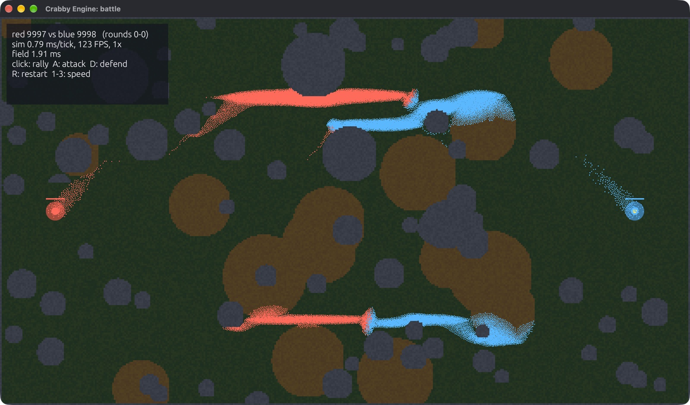

# Crabby Engine

Crabby Engine is a 2D game engine in Rust, built for games with huge numbers of
things in them: colonies, ecosystems, crowds, factories, swarms. The engine
keeps two goals in view:

- **Simulate a lot.** Millions of entities updated every tick on all CPU cores,
  separate from how many you draw. A sim can run without a window at all.
- **Stay easy to change.** Everything the engine does by itself is a plain
  system you can remove or replace. One obvious way to do each thing.



*The battle demo (`cargo run --release --example battle`): 20,000 units
on flow fields, under a millisecond of simulation per frame.
[Play it in your browser](play/battle/).*

It draws 3D too, on the same ECS, with the `3d` feature. 100,000 spinning
cubes with sun shadows run at 402 FPS, 7.5 times as fast as the same scene
in Unity 6 ([the benchmark](performance.md#3d-crabby-vs-unity),
[the 3D chapter](3d.md)).

```rust
use crabbyengine::*;

struct Vel(Vec2);

fn movement(ctx: &mut Ctx) {
    let dt = ctx.dt();
    ctx.world
        .query::<(&mut Transform2D, &Vel)>()
        .par_for_each(|(t, v)| t.position += v.0 * dt);
}

fn main() {
    Game::new("Crabs", 1280, 720)
        .sim_system(movement)
        .run(|ctx| {
            let crab = ctx.load_texture("crab.png");
            for i in 0..100_000 {
                let pos = vec2((i % 1280) as f32, (i / 1280) as f32 * 8.0);
                ctx.world.spawn((Transform2D::at(pos), Sprite::new(crab), Vel(vec2(20.0, 0.0))));
            }
        });
}
```

## How this book is laid out

- **Guide**: one chapter per idea, in the order you'll need them.
- **Reference**: benchmark numbers, the generated API docs, and how to
  contribute.

Every page is searchable: press `S` or click the magnifying glass.

## Status

Crabby Engine 1.0 is out, and its API follows semver from here on:
[STABILITY.md](https://github.com/bozoslav/crabbyengine/blob/main/STABILITY.md)
says what is promised (the API, the minimum Rust version, the C ABI, saved
worlds and determinism). Code in this book is kept in sync with the `main`
branch.
