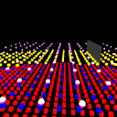

# Static batch follow-ups (#309)

Seven implementation items are covered here. Crossovers on other physical
adapters and in a real browser remain unmeasured; this is a partial delivery of
#309. Forced device limits on Metal are not browser measurements.

## Checklist evidence

| Item | Implementation and evidence |
|---|---|
| Native culling override | `Graphics::set_instance_batch_culling`, `ponko_ctx_set_instance_batch_culling`, and `ctx::set_instance_batch_culling`; C options layout unchanged. Rust API, FFI, C and C++ tests cover modes 0–2, invalid values and freed batches; FFI also covers null context. Renderer routing tests cover both preferences. |
| Deterministic GPU ties | Four stages produce a source-ordered visible list: local ranks, prefixes over groups of 64 cells, group prefixes, scatter. `check_batch_order` reads back active views and asserts strictly increasing source indices. Target-camera parity allows zero pixel outliers at the existing 2/255 channel tolerance, and each of eight poses is rendered 20 more times with byte-identical GPU output. The former two-pixel exception is removed. |
| Short-lived buffer churn | Eight consecutive empty frames before shrinking pages/pools. `short_lived_batches_reuse_buffers_then_expire_with_new_generations` performs twelve unload/reload cycles separated by three empty frames, asserts identical buffer generations and images, then verifies retirement and reuse after eight empty frames. Retirement runs even when the scene has no draws. |
| First recovered shadow frame | Invalidate before planning shadows whenever the previous frame skipped batch views. `views_past_the_frames_buffer_are_not_drawn_and_reported` compares the very first restored frame against the unlimited CPU reference, without the old two-frame wait. |
| Replacement generations | A shared monotonic buffer-generation counter is used for arena creation and growth. The streaming test checks pool replacement; `replaced_pages_keep_new_buffer_generations` checks page replacement and arena growth. |
| Material changes | Automatic batches using a changed material are rerouted immediately on a blend transition, in either direction. `material_blend_changes_reroute_auto_batches_without_transform_updates` covers both transitions, unchanged blend state, unaffected explicit GPU preference, and the live setter. |
| Exact CPU distance cost | Pack four centres/radii or origins and evaluate four exact distances with SIMD; no squared-distance approximation. `packed_distances_preserve_scalar_distance_and_boundary_selection` compares the resulting float bits to scalar distances for 12,288 points/eyes. Existing moving-camera, level, shadow and fallback parity tests remain. Release measurements below include one million instances with three distance levels and compute disabled. |
| Other adapters/browser crossovers | **Remaining:** run the crossover matrix on other physical adapters/backends and in real WebGPU/WebGL2 browsers, then assess the defaults. Thresholds remain provisional measurements from the original adapter. No browser or additional-adapter result is claimed. |

## Release measurements

Measured 2026-11-11 on Apple M4 Pro (12-core CPU, 24 GB), macOS 27.2.1
(26B131), Metal integrated GPU, driver version not reported by wgpu 30.0.1.
Rust 1.96.1, release profile, default features plus `3d`. Before: `a3da6f8` (the fetched engine main, after #308).
After: this change's four-stage compaction and packed-distance implementation.
All builds reuse the supplied shared build cache.

The existing offscreen benchmark uses 1280×720 Rgba8UnormSrgb, 4× MSAA, a depth
prepass, no post effects or atmosphere, no shadows in these rows. Cubes have
12 triangles, cells are 8 m wide; the camera moves 0.02 m/frame. Each row is
the best of five medians, each with 20 warm-up and 120 measured frames. Other
work was active on the machine; treat small frame-time changes as noise.

| Workload/path | Prepare µs before → after | Record µs before → after | Submit µs before → after | Culling GPU µs before → after | Whole GPU ms before → after | Frame ms before → after |
|---|---:|---:|---:|---:|---:|---:|
| 65,536 instances, GPU | 37 → 43 | 201 → 209 | 51 → 56 | 14 → 47 | 0.640 → 0.743 | 1.184 → 1.256 |
| 1,000,000 instances, GPU | 41 → 69 | 225 → 260 | 48 → 69 | 154 → 224 | 5.055 → 5.124 | 5.648 → 5.778 |
| 1,000,000 instances, CPU | 1009 → 284 | 945 → 228 | 163 → 59 | n/a | 5.425 → 5.389 | 8.848 → 6.296 |
| 1,000,000 instances, three levels, no compute | 859 → 478 | 198 → 175 | 59 → 31 | unavailable | unavailable | 6.733 → 6.374 |

Stable ordering has a measurable GPU cost: 70 µs more culling at one million
instances in this run. An initial serial cell-prefix implementation cost
775 µs; grouping the prefix work reduced it to 224 µs. This is a correctness
fix with a cost, not a GPU throughput improvement. CPU preparation improves
for both legacy sphere distances and exact level bands. The no-compute row
uses Metal with WebGL2 limits; timestamps are unavailable on that tier.

Per allocated level/view, compaction storage grows from approximately 4 to
8 bytes/instance, plus one word/cell and one word/group of 64 cells. It retains
four storage bindings. CPU packed distance data uses 16 bytes/instance, rounded
to four instances (previously 12 for level origins, 16 for legacy spheres). The steady preparation/recording allocation regressions
assert zero allocations in batch code (wgpu's own allocations are excluded).
Actual GPU resident memory and frame-time percentiles were not measured.

Reproduction (set `CARGO_TARGET_DIR` to the existing build cache):

```sh
PONKO_STATIC_BENCH='one batch' cargo test -p ponko --release --lib --features 3d static_batch_benchmark -- --ignored --nocapture
PONKO_GPU_TIER=webgl2 PONKO_STATIC_BENCH='million instance levels' cargo test -p ponko --release --lib --features 3d static_batch_benchmark -- --ignored --nocapture
PONKO_REQUIRE_GPU=1 PONKO_GPU_TIER=baseline cargo test -p ponko --lib --features 3d static_batch_render_test -- --nocapture --test-threads=1
```

The before level benchmark adds only the new scenario to the original source;
all renderer behavior remains the baseline. Baseline image capture similarly
adds only PNG output and stops after the first target-camera frame.

## Visual comparison

Before and after the shader change, same target-camera scene and baseline
limits on the adapter above: 128×128, Rgba8UnormSrgb, 4× MSAA, procedural meshes
and colours. Inspected both images: one changed pixel, maximum channel delta
1/255. GPU/CPU parity retains a 2/255 rounding allowance and zero outliers;
repeated GPU output is byte-identical. These are desktop offscreen images.

Before:


After:



Desktop/baseline and forced WebGL2 limits are exercised locally. Windows,
Linux adapters and actual browsers require their own runtime evidence.

## Integration validation

Rust 1.99.1 on the machine above:

```sh
cargo +1.99.1 fmt --all --check
cargo +1.99.1 build --workspace --examples
cargo +1.99.1 test --workspace
cargo +1.99.1 clippy --workspace --all-targets -- -D warnings
```

All four passed. The workspace test command was retried after explicitly
building `ponko_ffi` with 1.99.1: its first run reached the FFI doctests but
found an unversioned 1.96.1 rlib in the shared cache. The retry passed all
workspace tests, including all 880 FFI doctests. No cache was cleaned.

C/C++: explicit `cargo +1.99.1 build -p ponko_ffi`, then CMake configure/build
and CTest: **14/14 passed**, including the by-value ABI baseline and both setter
runtime suites. Native tests used a copy of the matching dylib inside the
same build cache, avoiding stale unversioned outputs. The dynamic symbol
check verified 723 primary exports and every legacy forwarding export.
Generated primary/compatibility headers, export coverage, naming inventory,
changelog fragments, dependency feature contracts and the guide build passed.
All 91 inline guide snippets compiled; another 130 blocks are included from
real source files, with zero ignored blocks. The legacy setter forwarding
body is also exercised directly by the FFI regression.

Additional reduced-build checks: the new Rust setter passes with no default
features and `3d`; the complete `three` integration file has 56 passes and
three shader-diagnostic failures in that configuration. All three failures
(`shader_errors_say_which_shader`, `compute_errors_say_which_pass`,
`effect_errors_say_which_effect`) reproduce unchanged on baseline `a3da6f8`:
shader validation is window-feature-dependent, but these tests expect it.
The FFI fixture likewise expects shader validation with window support absent;
it passes in the primary-only configuration with `--no-default-features
--features window`. These pre-existing diagnostic-test assumptions are outside
this change; no no-window whole-suite pass is claimed.
